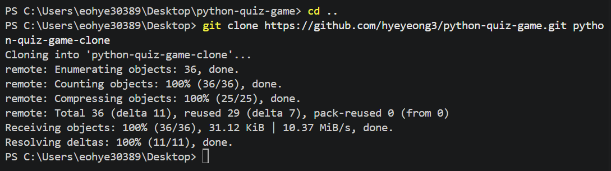
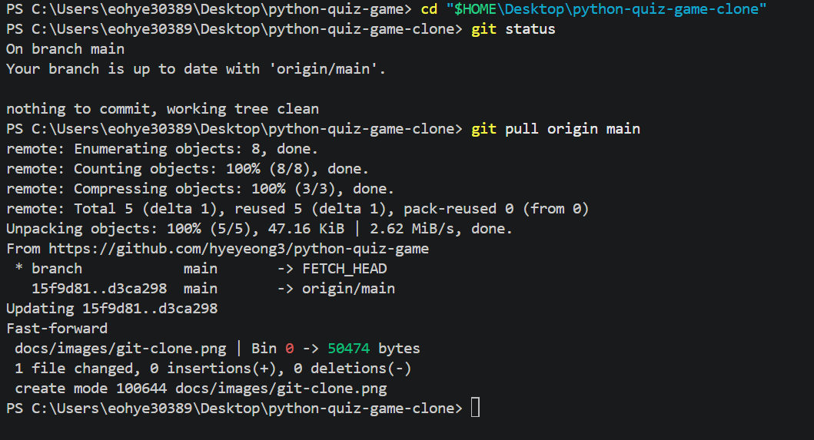
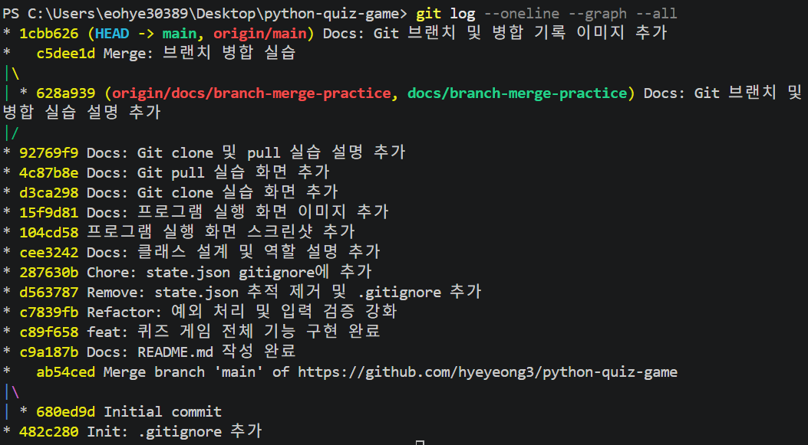

# python-quiz-game

## 📌 프로젝트 개요
저는 평소 게임에 대한 깊은 관심과 나만의 인디 게임을 개발하고 싶다는 꿈을 품고
코디세이 과정에 참여하게 되었습니다.
이번 과제를 통해 파이썬 프로그래밍의 기초를 익히는 동시에
게임 개발의 발판을 다지고자 합니다.
비록 코딩 비전공자이지만, 차근차근 과제를 완수해 나가는 것을 목표로 삼고 있습니다.

## 🎯 퀴즈 주제 선정 이유
기왕 퀴즈를 만드는 겸 제가 잘 이해하고 흥미를 느낄 수 있는 주제로 하자는 마음에,
게임에 관한 잡다한 뒷이야기와 여담을 주제로 선정했습니다.
이 퀴즈를 보시는 분들 중 게임을 잘 아시는 분들께는 가벼운 재미를,
잘 모르시는 분들께는 소소한 흥미를 전할 수 있기를 바라는 마음도 담았습니다.

## ⚙️ 기능 목록
- 게임 관련 퀴즈 객관식 문제 출제
- 문제마다 정답/오답 즉시 피드백
- 최종 점수 및 결과 메시지 출력
- 퀴즈 종료 후 재시작 여부 선택

🛠️ 개발 환경
Python 3.12 (64-bit)
터미널 : PowerShell

## ▶️ 실행 방법
1. 이 저장소를 클론합니다.

```bash
git clone https://github.com/hyeyeong3/python-quiz-game.git
```

2. 폴더로 이동합니다.

```bash
cd python-quiz-game
```

3. 퀴즈 게임을 실행합니다.

```bash
python main.py
```

🗂️ 파일 구조
python-quiz-game/
│
├── main.py       # 게임 실행 메인 파일
├── quiz.py       # 퀴즈 관련 클래스 및 기능 구현 파일
├── .gitignore    # Git 추적 제외 파일 및 폴더 설정
└── README.md     # 프로젝트 설명 파일

📂 데이터 파일 설명
파일명	설명
main.py	게임 시작, 흐름 제어, 결과 출력 담당
quiz_data.py	퀴즈 문제, 보기, 정답을 리스트로 저장
utils.py	점수 계산, 입력 검증 등 보조 기능 담당

## 🖥️ 프로그램 실행 화면

프로그램을 실행하면 다음과 같이 퀴즈 게임의 메인 메뉴가 출력된다.


## 🧩 클래스 설계 및 역할

본 프로젝트는 퀴즈 문제를 관리하는 `Quiz` 클래스와 게임의 전체적인 기능을 관리하는 `QuizGame` 클래스로 구성하였다.

각 클래스의 역할을 분리하여 코드의 가독성을 높이고, 기능별로 관리하기 쉽도록 설계하였다.

### 1. Quiz 클래스

`Quiz` 클래스는 퀴즈 문제 하나에 대한 정보를 저장하고 관리하는 역할을 담당한다.

- `question`: 퀴즈 문제 내용
- `options`: 4개의 선택지 보기 리스트
- `answer`: 정답 번호 (1\~4)

**주요 메서드**

- `__init__()`: 퀴즈 객체를 생성하고 문제, 선택지, 정답을 초기화한다.
- `to_dict()`: 퀴즈 객체의 정보를 딕셔너리로 변환한다. JSON 파일에 저장할 때 사용한다.
- `from_dict()`: 딕셔너리 형태의 데이터를 Quiz 객체로 변환한다. JSON 파일에서 데이터를 불러올 때 사용한다.

### 2. QuizGame 클래스

`QuizGame` 클래스는 퀴즈 게임의 전반적인 기능과 데이터를 관리하는 역할을 담당한다.

**주요 속성**

- `quizzes`: 게임에 등록된 퀴즈 객체들을 저장하는 리스트
- `high_score`: 사용자가 기록한 최고 점수
- `STATE_FILE`: 퀴즈와 최고 점수를 저장하는 JSON 파일의 이름

**주요 역할**

- 퀴즈 데이터와 최고 점수의 저장 및 불러오기
- 기본 퀴즈 데이터 초기화
- 퀴즈 출제 및 정답 확인
- 새로운 퀴즈 추가
- 등록된 퀴즈 목록 출력
- 최고 점수 확인
- 사용자 입력값 검증

### 3. 클래스 간의 관계

`QuizGame` 클래스는 여러 개의 `Quiz` 객체를 리스트 형태로 관리한다.

퀴즈를 추가할 때 새로운 `Quiz` 객체를 생성하여 `quizzes` 리스트에 등록하며, 퀴즈를 진행할 때는 리스트에 저장된 객체의 문제, 선택지, 정답 정보를 활용한다.

이처럼 `Quiz` 클래스는 개별 퀴즈 데이터를 담당하고, `QuizGame` 클래스는 여러 퀴즈를 활용한 게임 진행과 전체 관리를 담당하도록 역할을 분리한 것이다.

### 4. 클래스 사용 이유 및 추상화와 재사용성

본 프로젝트에서 클래스를 사용한 이유는 퀴즈 데이터와 게임 진행 기능을 구분하여 관리하고, 코드의 가독성과 유지보수성을 높이기 위해서이다.

**1. 추상화**

추상화란 복잡한 세부 구현을 모두 다루기보다는 필요한 데이터와 기능을 하나의 단위로 묶어 표현하는 것이다.

- `Quiz` 클래스는 하나의 퀴즈에 필요한 문제, 선택지, 정답 정보를 하나의 객체로 묶어 관리한다.
- `QuizGame` 클래스는 여러 퀴즈 객체를 활용하여 게임 진행, 점수 관리, 데이터 저장 및 불러오기 등의 기능을 제공한다.

이처럼 각 클래스가 담당하는 기능을 구분하여 전체 프로그램의 구조를 이해하고 관리하기 쉽도록 하였다.

**2. 재사용성**

클래스를 사용하면 동일한 구조의 객체를 필요할 때마다 생성하여 활용할 수 있다.

- `Quiz` 클래스는 동일한 생성 방식을 이용하여 여러 개의 퀴즈 객체를 만들 수 있다.
- 새 퀴즈를 추가할 때도 기존 `Quiz` 클래스를 활용하므로 퀴즈마다 별도의 데이터 관리 코드를 작성할 필요가 없다.
- `to_dict()`와 `from_dict()` 메서드를 활용하여 여러 퀴즈 객체를 동일한 방식으로 JSON 데이터로 변환하거나 복원할 수 있다.

따라서 클래스별 역할을 분리함으로써 중복 코드를 줄이고, 새로운 퀴즈를 추가하거나 기존 기능을 수정할 때도 효율적으로 관리할 수 있도록 설계하였다.

## 🔄 Git clone 및 pull 실습

GitHub 저장소를 로컬 컴퓨터에 복제하는 `git clone` 명령어와 원격 저장소의 최신 변경 사항을 가져오는 `git pull` 명령어를 직접 실행하였다.

### 1. Git clone 실습

`git clone` 명령어를 사용하여 GitHub 저장소를 로컬 컴퓨터에 복제하였다.



### 2. Git pull 실습

복제한 저장소에서 `git pull origin main` 명령어를 실행하여 원격 저장소의 변경 사항을 정상적으로 가져오는 것을 확인하였다.



## 🌿 Git 브랜치 및 병합 실습

프로젝트의 기존 코드에 영향을 주지 않고 별도의 작업을 진행하기 위해 새로운 브랜치를 생성하였다.

- `main`: 프로젝트의 기본 브랜치
- `docs/branch-merge-practice`: 브랜치 및 병합 실습을 위한 작업 브랜치

새로운 브랜치에서 README 문서를 수정하고 커밋한 후, 해당 변경 사항을 `main` 브랜치에 병합하였다.

다음은 Git 브랜치 생성 및 병합 과정을 확인할 수 있는 커밋 그래프이다.


이를 통해 Git의 브랜치 생성, 전환, 커밋 및 병합 과정을 실습하였다.

## 📝 Git 커밋 기록

프로젝트를 개발하면서 기능 구현, 코드 개선, 문서 작성 및 실습 자료 추가 등 작업 단위별로 커밋을 진행하였다.

각 작업의 변경 사항을 구분할 수 있도록 의미 있는 커밋 메시지를 작성하였으며, 전체 커밋 기록은 GitHub 저장소에서 확인할 수 있다.

- 커밋 개수: 10회 이상
- 커밋 메시지: 작업 내용을 알 수 있도록 작성
- 작업 기록: 기능 구현, 리팩토링, 문서 작성 및 Git 실습

### 커밋 기록 확인

[GitHub 커밋 기록 바로가기](https://github.com/hyeyeong3/python-quiz-game/commits/main)



## 🔧 함수 및 메서드의 책임 분리

## 🔄 프로그램 실행 흐름

## 💾 데이터 저장 및 불러오기

## ⚠️ 예외 처리 및 안전 종료

## 🔐 데이터 백업 및 복구 정책

## 📈 대규모 데이터 처리 및 성능 고려

## 🔄 요구사항 변경 시 수정 대상

