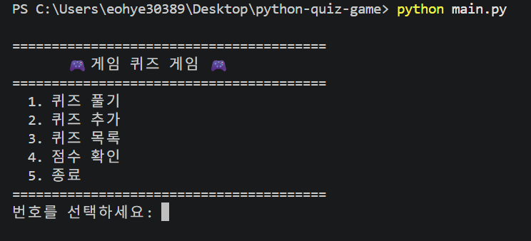
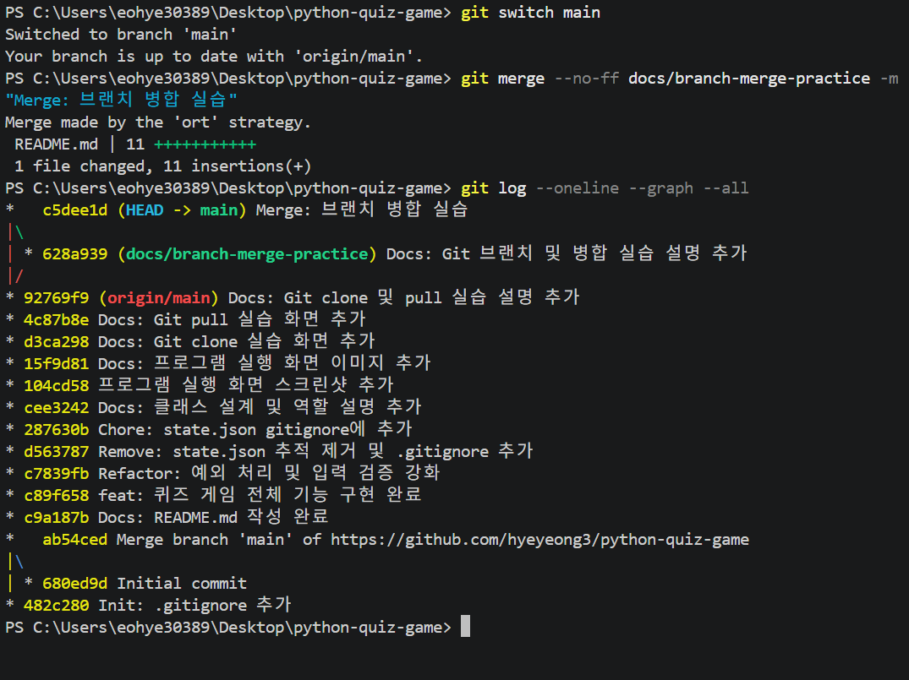

# python-quiz-game

## 📌 프로젝트 개요
저는 평소 게임에 대한 깊은 관심과 나만의 인디 게임을 개발하고 싶다는 꿈을 품고
코디세이 과정에 참여하게 되었습니다.
이번 과제를 통해 파이썬 프로그래밍의 기초를 익히는 동시에
게임 개발의 발판을 다지고자 합니다.
비록 코딩 비전공자이지만, 차근차근 과제를 완수해 나가는 것을 목표로 삼고 있습니다.

## 🎯 퀴즈 주제 선정 이유
기왕 퀴즈를 만드는 겸 제가 잘 이해하고 흥미를 느낄 수 있는 주제로 하자는 마음에,
게임에 관한 잡다한 뒷이야기와 여담을 주제로 선정했습니다.
이 퀴즈를 보시는 분들 중 게임을 잘 아시는 분들께는 가벼운 재미를,
잘 모르시는 분들께는 소소한 흥미를 전할 수 있기를 바라는 마음도 담았습니다.

## ⚙️ 기능 목록
- 게임 관련 퀴즈 객관식 문제 출제
- 문제마다 정답/오답 즉시 피드백
- 최종 점수 및 결과 메시지 출력
- 퀴즈 종료 후 재시작 여부 선택

## 🛠️ 개발 환경

- **운영체제:** Windows 11, 버전 26H2 (OS 빌드 26300.9974)
- **프로그래밍 언어:** Python 3.12.10 (64-bit)
- **개발 도구:** Visual Studio Code 1.146.0 (64-bit)
- **터미널:** Windows PowerShell 5.1.26100.9818
- **버전 관리 도구:** Git 2.56.0.windows.4


## ▶️ 실행 방법
1. 이 저장소를 클론합니다.

```bash
git clone https://github.com/hyeyeong3/python-quiz-game.git
```

2. 폴더로 이동합니다.

```bash
cd python-quiz-game
```

3. 퀴즈 게임을 실행합니다.

```bash
python main.py
```

## 🗂️ 파일 구조

```text
python-quiz-game/
│
├── main.py                  # 게임 실행 메인 파일
├── quiz.py                  # 퀴즈 관련 클래스 및 기능 구현 파일
├── .gitignore               # Git 추적 제외 파일 및 폴더 설정
├── README.md                # 프로젝트 설명 파일
│
└── docs/
    └── images/              # README 및 과제 증빙에 사용하는 이미지 파일
        ├── menu-execution.png
        ├── git-commit-history.png
        ├── git-branch-merge.png
        ├── git-clone.png
        ├── git-pull.png
        └── os version_image.png
```

## 📂 폴더 및 파일 설명

- `main.py`: 프로그램 실행 및 메인 메뉴 처리
- `quiz.py`: Quiz와 QuizGame 클래스 및 퀴즈 관련 기능 구현
- `.gitignore`: Git에서 추적하지 않을 파일 및 폴더 지정
- `README.md`: 프로젝트 개요, 실행 방법, 기능 및 개발 과정 설명
- `docs/images/`: 프로그램 실행 화면과 Git 작업 과정 등 과제 제출에 필요한 이미지 보관

## 🖥️ 프로그램 실행 화면

프로그램을 실행하면 다음과 같이 퀴즈 게임의 메인 메뉴가 출력된다.



## 🧩 클래스 설계 및 역할

본 프로젝트는 퀴즈 문제를 관리하는 `Quiz` 클래스와 게임의 전체적인 기능을 관리하는 `QuizGame` 클래스로 구성하였다.

각 클래스의 역할을 분리하여 코드의 가독성을 높이고, 기능별로 관리하기 쉽도록 설계하였다.

### 1. Quiz 클래스

`Quiz` 클래스는 퀴즈 문제 하나에 대한 정보를 저장하고 관리하는 역할을 담당한다.

- `question`: 퀴즈 문제 내용
- `options`: 4개의 선택지 보기 리스트
- `answer`: 정답 번호 (1\~4)

**주요 메서드**

- `__init__()`: 퀴즈 객체를 생성하고 문제, 선택지, 정답을 초기화한다.
- `to_dict()`: 퀴즈 객체의 정보를 딕셔너리로 변환한다. JSON 파일에 저장할 때 사용한다.
- `from_dict()`: 딕셔너리 형태의 데이터를 Quiz 객체로 변환한다. JSON 파일에서 데이터를 불러올 때 사용한다.

### 2. QuizGame 클래스

`QuizGame` 클래스는 퀴즈 게임의 전반적인 기능과 데이터를 관리하는 역할을 담당한다.

**주요 속성**

- `quizzes`: 게임에 등록된 퀴즈 객체들을 저장하는 리스트
- `high_score`: 사용자가 기록한 최고 점수
- `STATE_FILE`: 퀴즈와 최고 점수를 저장하는 JSON 파일의 이름

**주요 역할**

- 퀴즈 데이터와 최고 점수의 저장 및 불러오기
- 기본 퀴즈 데이터 초기화
- 퀴즈 출제 및 정답 확인
- 새로운 퀴즈 추가
- 등록된 퀴즈 목록 출력
- 최고 점수 확인
- 사용자 입력값 검증

### 3. 클래스 간의 관계

`QuizGame` 클래스는 여러 개의 `Quiz` 객체를 리스트 형태로 관리한다.

퀴즈를 추가할 때 새로운 `Quiz` 객체를 생성하여 `quizzes` 리스트에 등록하며, 퀴즈를 진행할 때는 리스트에 저장된 객체의 문제, 선택지, 정답 정보를 활용한다.

이처럼 `Quiz` 클래스는 개별 퀴즈 데이터를 담당하고, `QuizGame` 클래스는 여러 퀴즈를 활용한 게임 진행과 전체 관리를 담당하도록 역할을 분리한 것이다.

### 4. 클래스 사용 이유 및 추상화와 재사용성

본 프로젝트에서 클래스를 사용한 이유는 퀴즈 데이터와 게임 진행 기능을 구분하여 관리하고, 코드의 가독성과 유지보수성을 높이기 위해서이다.

**1. 추상화**

추상화란 복잡한 세부 구현을 모두 다루기보다는 필요한 데이터와 기능을 하나의 단위로 묶어 표현하는 것이다.

- `Quiz` 클래스는 하나의 퀴즈에 필요한 문제, 선택지, 정답 정보를 하나의 객체로 묶어 관리한다.
- `QuizGame` 클래스는 여러 퀴즈 객체를 활용하여 게임 진행, 점수 관리, 데이터 저장 및 불러오기 등의 기능을 제공한다.

이처럼 각 클래스가 담당하는 기능을 구분하여 전체 프로그램의 구조를 이해하고 관리하기 쉽도록 하였다.

**2. 재사용성**

클래스를 사용하면 동일한 구조의 객체를 필요할 때마다 생성하여 활용할 수 있다.

- `Quiz` 클래스는 동일한 생성 방식을 이용하여 여러 개의 퀴즈 객체를 만들 수 있다.
- 새 퀴즈를 추가할 때도 기존 `Quiz` 클래스를 활용하므로 퀴즈마다 별도의 데이터 관리 코드를 작성할 필요가 없다.
- `to_dict()`와 `from_dict()` 메서드를 활용하여 여러 퀴즈 객체를 동일한 방식으로 JSON 데이터로 변환하거나 복원할 수 있다.

따라서 클래스별 역할을 분리함으로써 중복 코드를 줄이고, 새로운 퀴즈를 추가하거나 기존 기능을 수정할 때도 효율적으로 관리할 수 있도록 설계하였다.

## 🔄 Git clone 및 pull 실습

GitHub 저장소를 로컬 컴퓨터에 복제하는 `git clone` 명령어와 원격 저장소의 최신 변경 사항을 가져오는 `git pull` 명령어를 직접 실행하였다.

### 1. Git clone 실습

`git clone` 명령어를 사용하여 GitHub 저장소를 로컬 컴퓨터에 복제하였다.


### 2. Git pull 실습

복제한 저장소에서 `git pull origin main` 명령어를 실행하여 원격 저장소의 변경 사항을 정상적으로 가져오는 것을 확인하였다.


## 🌿 Git 브랜치 및 병합 실습

프로젝트의 기존 코드에 영향을 주지 않고 별도의 작업을 진행하기 위해 새로운 브랜치를 생성하였다.

- `main`: 프로젝트의 기본 브랜치
- `docs/branch-merge-practice`: 브랜치 및 병합 실습을 위한 작업 브랜치

새로운 브랜치에서 README 문서를 수정하고 커밋한 후, 해당 변경 사항을 `main` 브랜치에 병합하였다.

다음은 Git 브랜치 생성 및 병합 과정을 확인할 수 있는 커밋 그래프이다.



이를 통해 Git의 브랜치 생성, 전환, 커밋 및 병합 과정을 실습하였다.

## 📝 Git 커밋 기록

프로젝트를 개발하면서 기능 구현, 코드 개선, 문서 작성 및 실습 자료 추가 등 작업 단위별로 커밋을 진행하였다.

각 작업의 변경 사항을 구분할 수 있도록 의미 있는 커밋 메시지를 작성하였으며, 전체 커밋 기록은 GitHub 저장소에서 확인할 수 있다.

- 커밋 개수: 10회 이상
- 커밋 메시지: 작업 내용을 알 수 있도록 작성
- 작업 기록: 기능 구현, 리팩토링, 문서 작성 및 Git 실습

### 커밋 기록 확인

[GitHub 커밋 기록 바로가기](https://github.com/hyeyeong3/python-quiz-game/commits/main)


## ⚙️ 기능별 로직 분리 및 호출 흐름

본 프로젝트는 코드의 가독성과 유지보수성을 높이기 위해 입력 처리, 게임 진행, 데이터 입출력 기능을 각각의 메서드로 분리하였다.

각 기능이 담당하는 역할을 구분하여 하나의 메서드에 모든 작업이 집중되지 않도록 설계하였다.

### 1. 입력 처리 로직

사용자가 입력한 값이 올바른지 확인하고, 잘못된 입력이 들어오면 다시 입력하도록 처리한다.

- `_input_number()`: 숫자 입력을 받고, 빈 입력이나 숫자 변환 실패, 지정된 범위를 벗어난 값을 검사한다. 잘못된 입력이 들어오면 안내 메시지를 출력하고 다시 입력받는다.
- `_input_text()`: 문제와 선택지 등의 텍스트를 입력받으며, 빈 문자열이 입력되지 않도록 검사한다.
- `main.py`의 `main()`: 메인 메뉴에서 사용자가 입력한 번호를 확인하고, 올바른 메뉴 기능을 실행한다.

입력 검증 기능을 별도의 메서드로 분리하여 퀴즈 추가와 퀴즈 진행 등 여러 기능에서 공통으로 활용할 수 있도록 하였다.

### 2. 게임 진행 로직

퀴즈와 관련된 실제 기능을 담당하는 메서드이다.

- `play_quiz()`: 등록된 퀴즈를 무작위 순서로 출제하고, 사용자의 답을 확인하여 점수를 계산한다. 새로운 최고 점수가 기록되면 저장 기능을 호출한다.
- `add_quiz()`: 문제와 4개의 선택지, 정답 번호를 입력받아 새로운 Quiz 객체를 생성하고 퀴즈 목록에 추가한다.
- `show_quiz_list()`: 등록된 퀴즈와 선택지를 화면에 출력한다.
- `show_high_score()`: 현재 저장된 최고 점수를 출력한다.

게임 진행 메서드는 필요한 입력을 입력 처리 메서드에 요청하고, 데이터가 변경되면 저장 메서드를 호출하는 방식으로 구성하였다.

### 3. 데이터 입출력 로직

프로그램 실행 중 사용하는 퀴즈 목록과 최고 점수를 JSON 파일로 저장하고 불러오는 기능이다.

- `load_state()`: 프로그램이 시작되어 `QuizGame` 객체가 생성될 때 실행된다. `state.json` 파일이 존재하면 데이터를 불러오고, 파일이 없으면 기본 퀴즈를 초기화한다.
- `save_state()`: 퀴즈 추가 또는 최고 점수 갱신 시 변경된 데이터를 `state.json`에 저장한다. 프로그램이 `KeyboardInterrupt` 또는 `EOFError`로 종료되는 경우에도 저장을 시도한다.
- `to_dict()`: Quiz 객체를 JSON 저장에 사용할 수 있는 딕셔너리 형태로 변환한다.
- `from_dict()`: JSON에서 불러온 딕셔너리 데이터를 Quiz 객체로 변환한다.

데이터 저장과 불러오기 기능을 별도로 분리하여 게임 진행 로직에서 파일 처리 코드를 반복하지 않도록 하였다.

### 4. 기능별 호출 흐름

각 기능은 다음과 같은 순서로 연결된다.

**① 프로그램 실행 및 데이터 불러오기**

`main.py` 실행 → `QuizGame()` 객체 생성 → `load_state()` 실행 → `state.json` 데이터 불러오기

**② 퀴즈 진행**

메인 메뉴에서 퀴즈 풀기 선택 → `play_quiz()` 실행 → `_input_number()`로 정답 입력 및 검증 → 정답 확인 및 점수 계산 → 최고 점수 갱신 시 `save_state()` 실행

**③ 퀴즈 추가**

메인 메뉴에서 퀴즈 추가 선택 → `add_quiz()` 실행 → `_input_text()`와 `_input_number()`로 입력 및 검증 → Quiz 객체 생성 → 퀴즈 목록에 추가 → `save_state()` 실행

**④ 프로그램 종료**

일반 종료 또는 `KeyboardInterrupt`, `EOFError` 발생 → 비정상 입력 종료 시 `main.py`에서 `save_state()` 실행 → 프로그램 종료

이처럼 입력 처리, 게임 진행, 데이터 입출력 기능을 구분하여 각 메서드가 자신의 역할에 집중하도록 하였다. 이를 통해 코드의 중복을 줄이고 기능별 수정과 관리가 쉽도록 설계하였다.

## 💾 데이터 로드 및 저장 흐름

본 프로젝트는 프로그램을 실행할 때 `state.json`에 저장된 데이터를 불러오고, 퀴즈나 최고 점수가 변경될 때 데이터를 저장하도록 구성하였다.

데이터를 불러오는 시점과 저장하는 시점을 구분하여 프로그램을 다시 실행하더라도 이전에 추가한 퀴즈와 최고 점수를 유지할 수 있도록 설계하였다.

### 1. 데이터 로드 시점

프로그램이 시작되면 `main.py`에서 `QuizGame()` 객체를 생성한다.

이때 `QuizGame` 클래스의 `__init__()` 메서드가 실행되며, 초기화 과정에서 `load_state()` 메서드를 호출한다.

- `state.json` 파일이 존재하면 JSON 데이터를 읽어 퀴즈 목록과 최고 점수를 불러온다.
- 파일이 존재하지 않으면 기본 퀴즈 5개를 초기화하고 `save_state()`를 호출하여 파일을 생성한다.
- JSON 파일이 손상되어 데이터를 정상적으로 불러올 수 없으면 기본 퀴즈와 초기 최고 점수로 복구한 후 다시 저장한다.

### 2. 데이터 저장 시점

데이터는 다음과 같은 상황에서 `save_state()` 메서드를 호출하여 저장한다.

- **퀴즈 추가:** 새로운 퀴즈 객체를 목록에 등록한 직후 저장한다.
- **최고 점수 갱신:** 사용자가 기존 최고 점수보다 높은 점수를 획득하면 갱신된 점수를 저장한다.
- **예외 상황에서 종료:** `KeyboardInterrupt` 또는 `EOFError`가 발생하면 `main.py`에서 저장을 시도한 후 프로그램을 종료한다.

일반적인 종료 메뉴를 선택하는 경우에는 별도의 저장 메서드를 호출하지 않는다. 퀴즈 추가와 최고 점수 갱신 시 이미 저장을 완료하기 때문이다.

### 3. 데이터 처리 순서

프로그램의 데이터 처리 과정은 다음과 같다.

1. `main.py` 실행
2. `QuizGame()` 객체 생성
3. `__init__()`에서 `load_state()` 호출
4. `state.json` 파일 확인 및 데이터 불러오기
5. 메인 메뉴를 통해 게임 기능 실행
6. 퀴즈 추가 또는 최고 점수 갱신 시 `save_state()` 호출
7. 프로그램 종료

이러한 구조를 통해 프로그램 시작 시 기존 데이터를 불러오고, 데이터가 변경되는 시점에 저장하여 프로그램을 다시 실행해도 변경된 내용을 유지할 수 있도록 하였다.

## 🛑 예외 상황 및 프로그램 종료 처리

본 프로젝트는 프로그램 실행 중 사용자가 예기치 않게 종료를 시도하는 경우에도 데이터 손실을 최소화할 수 있도록 예외 처리를 적용하였다.

### 1. 예외 상황 처리

프로그램의 메인 실행 부분인 `main.py`에서는 다음 두 가지 예외를 처리한다.

- `KeyboardInterrupt`: 사용자가 터미널에서 `Ctrl + C`를 눌러 프로그램을 중단하는 경우 발생한다.
- `EOFError`: 입력을 더 이상 받을 수 없는 상황에서 발생한다.

두 예외가 발생하면 `game.save_state()`를 호출하여 현재 퀴즈 데이터와 최고 점수를 `state.json`에 저장한 후 프로그램을 종료하도록 구성하였다.

### 2. 종료 처리 흐름

프로그램의 종료 처리 순서는 다음과 같다.

1. 사용자가 `Ctrl + C`를 누르거나 입력 종료 상황이 발생한다.
2. `KeyboardInterrupt` 또는 `EOFError` 예외가 발생한다.
3. `main.py`의 예외 처리 구문에서 해당 예외를 감지한다.
4. `game.save_state()`를 호출하여 현재 데이터를 저장한다.
5. 종료 안내를 출력하고 프로그램을 종료한다.

### 3. 추가 개선 방안

현재 프로젝트는 `KeyboardInterrupt`와 `EOFError`를 중심으로 종료 상황을 처리하고 있다.

추가로 운영체제에서 전달하는 종료 신호까지 처리하려면 Python의 `signal` 모듈을 활용할 수 있다. 예를 들어 `SIGTERM` 신호를 감지하여 종료 전에 데이터를 저장하도록 확장할 수 있다.

다만 현재 코드에는 별도의 `signal` 모듈 처리가 구현되어 있지 않으며, 이는 향후 개선할 수 있는 사항이다.

## 📌 Git 커밋 단위 및 메시지 작성 규칙

본 프로젝트는 변경 사항을 체계적으로 관리하고 작업 이력을 쉽게 확인할 수 있도록 작업 단위별로 커밋을 진행하였다.

### 1. 커밋 단위 규칙

커밋은 하나의 명확한 작업 목적을 기준으로 구분한다.

- 하나의 기능을 추가하거나 수정한 경우 해당 작업을 하나의 커밋으로 기록한다.
- 오류 수정과 코드 구조 개선은 각각 별도의 커밋으로 구분한다.
- README 수정이나 이미지 추가 등 문서 관련 작업도 별도로 커밋한다.
- 서로 다른 목적의 변경 사항을 하나의 커밋에 불필요하게 묶지 않는다.
- 작업이 완료된 후 변경 사항을 확인하고 커밋한다.

### 2. 커밋 메시지 작성 규칙

커밋 메시지는 작업의 종류와 변경 내용을 쉽게 파악할 수 있도록 다음 형식을 사용한다.

**메시지 형식**

`작업유형: 변경 내용`

**작업 유형별 구분**

| 유형 | 의미 | 사용 예시 |
|---|---|---|
| Feat | 새로운 기능 추가 | `Feat: 퀴즈 추가 기능 구현` |
| Fix | 오류 수정 | `Fix: 잘못된 입력 처리 오류 수정` |
| Refactor | 코드 구조 개선 | `Refactor: 입력 검증 로직 분리` |
| Docs | 문서 수정 및 추가 | `Docs: README 실행 방법 추가` |
| Chore | 설정 및 기타 관리 작업 | `Chore: .gitignore 설정 수정` |

### 3. 커밋 메시지 작성 시 유의 사항

- 변경 사항의 핵심 내용을 간결하고 명확하게 작성한다.
- '수정', '완료'와 같이 구체적인 작업 내용을 알기 어려운 표현은 피한다.
- 커밋 메시지만 확인해도 어떤 작업을 진행했는지 파악할 수 있도록 작성한다.
- 작업 내용과 커밋 메시지가 서로 일치하도록 한다.

이러한 규칙을 통해 작업 이력을 체계적으로 관리하고, 문제가 발생했을 때 변경 사항을 쉽게 추적할 수 있도록 하였다.

## 📌 JSON 데이터 저장 형식을 선택한 이유

본 프로젝트에서는 퀴즈 데이터와 최고 점수를 저장하고 불러오기 위한 데이터 형식으로 JSON을 선택하였다.

### 1. 가독성

JSON은 사람이 읽고 이해하기 쉬운 텍스트 형식이다. 따라서 `state.json` 파일을 직접 열어 퀴즈의 문제, 선택지, 정답 및 최고 점수 등의 저장 내용을 쉽게 확인할 수 있다.

또한 데이터에 문제가 발생했을 때 파일의 내용을 직접 확인하여 원인을 파악하기에도 편리하다.

### 2. 데이터의 구조화

JSON은 키(Key)와 값(Value)을 이용해 데이터를 구분하여 저장할 수 있다.

본 프로젝트에서는 퀴즈의 문제, 선택지, 정답을 각각 구분하고, 여러 퀴즈 데이터를 목록 형태로 관리한다. 최고 점수와 같은 별도의 정보도 함께 저장할 수 있어 데이터의 구조를 명확하게 표현할 수 있다.

### 3. Python과의 연동

Python은 기본 제공되는 `json` 모듈을 통해 JSON 데이터를 쉽게 저장하고 불러올 수 있다.

본 프로젝트에서는 `Quiz` 클래스의 `to_dict()` 메서드를 사용해 퀴즈 객체를 딕셔너리로 변환하고, `from_dict()` 메서드를 통해 저장된 딕셔너리 데이터를 다시 퀴즈 객체로 복원한다.

이를 통해 객체 형태의 데이터를 JSON 파일에 저장하고 프로그램 실행 시 다시 사용할 수 있도록 구성하였다.

### 4. JSON 선택의 결과

JSON은 사람이 확인하기 쉬우면서도 데이터의 구조를 명확하게 표현할 수 있고, Python에서 별도의 외부 라이브러리 없이 사용할 수 있다는 장점이 있다.

이러한 이유로 본 프로젝트의 데이터 저장 형식으로 JSON을 선택하였다.

## 📌 요구사항 변경에 따른 수정 대상 및 우선순위

프로그램의 요구사항이 변경되면 변경 내용에 따라 관련된 클래스와 메서드를 확인하고, 영향 범위를 분석한 뒤 수정한다.

### 1. 변경 유형별 수정 대상

| 변경 유형 | 주요 수정 대상 | 수정 내용 |
|---|---|---|
| 점수 계산 방식 변경 | `QuizGame` 클래스의 `play_quiz()` | 정답 판정 및 점수 계산 로직 수정 |
| 퀴즈 데이터 항목 추가 또는 변경 | `Quiz` 클래스 | 속성, 생성자 및 데이터 변환 메서드 수정 |
| 퀴즈 저장 형식 변경 | `QuizGame` 클래스의 `load_state()`, `save_state()` | 데이터 저장 및 불러오기 방식 수정 |
| 퀴즈 추가 기능 변경 | `QuizGame` 클래스의 `add_quiz()` | 퀴즈 입력 및 객체 생성 과정 수정 |
| 메뉴 또는 사용자 입력 변경 | `main.py`, `QuizGame` 클래스의 입력 메서드 | 메뉴 구성 및 입력 검증 로직 수정 |

### 2. 변경 영향도 분석

**① 점수 계산 방식이 변경되는 경우**

- 수정 대상: `quiz.py`의 `QuizGame.play_quiz()`
- 영향 범위: 정답 판정, 점수 계산, 최고 점수 갱신
- 확인 사항: 변경된 점수 계산 방식이 최고 점수 저장에도 올바르게 반영되는지 테스트한다.

**② 퀴즈 데이터 구조가 변경되는 경우**

- 수정 대상: `quiz.py`의 `Quiz` 클래스
- 영향 범위: 퀴즈 객체 생성, 딕셔너리 변환, JSON 데이터 복원
- 확인 사항: `__init__()`, `to_dict()`, `from_dict()`가 새로운 데이터 구조와 일치하는지 확인한다.

**③ 데이터 저장 방식이 변경되는 경우**

- 수정 대상: `quiz.py`의 `QuizGame.load_state()`, `QuizGame.save_state()`
- 영향 범위: 데이터 파일 읽기, 저장, 프로그램 재실행 후 데이터 복원
- 확인 사항: 기존에 저장된 데이터와의 호환성 및 데이터 손실 가능성을 확인한다.

### 3. 수정 작업 우선순위

요구사항 변경 시 다음 순서로 작업한다.

1. **변경 요구사항 분석:** 변경된 내용과 기존 기능에 미치는 영향을 파악한다.
2. **데이터 구조 확인:** 퀴즈 데이터 항목이나 저장 형식이 변경되는지 먼저 확인한다.
3. **핵심 로직 수정:** 점수 계산, 퀴즈 모델 등 변경 요구사항과 직접 관련된 부분을 수정한다.
4. **데이터 입출력 확인:** 변경된 데이터 구조가 저장 및 불러오기 과정에 정상적으로 반영되는지 확인한다.
5. **연관 기능 테스트:** 퀴즈 진행, 퀴즈 추가, 목록 확인, 최고 점수 확인 및 프로그램 재실행을 테스트한다.

### 4. 유지보수 시 고려 사항

- 한 가지 기능을 수정하더라도 해당 기능과 연결된 다른 메서드에 영향이 있는지 확인한다.
- 데이터 구조를 변경할 때는 기존 `state.json` 데이터와의 호환성을 고려한다.
- 수정 후에는 기존 기능이 정상적으로 작동하는지 회귀 테스트를 진행한다.
- 변경 사항은 Git 커밋으로 기록하여 수정 이력을 추적할 수 있도록 한다.

이와 같은 변경 영향도 분석을 통해 불필요한 코드 수정을 줄이고, 요구사항 변경 이후에도 프로그램의 기존 기능이 안정적으로 유지되도록 한다.